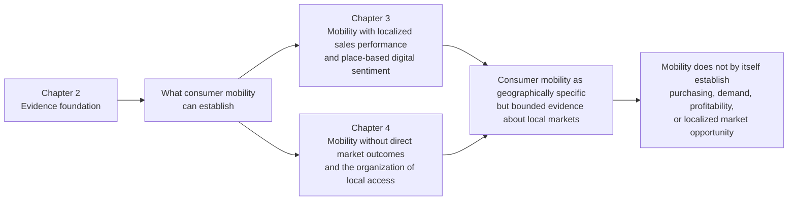

# Consumer Mobility as Evidence About Local Markets

**Research materials for a three-paper PhD dissertation on consumer mobility, local sales, place-based digital sentiment, and the spatial organization of local market access.**

This repository contains the code, documentation, data dictionaries, and non-restricted supporting materials associated with Rafael Pereira Albuquerque’s PhD dissertation in Business Administration, with an emphasis in Marketing, at the Federal University of Rio Grande do Sul (UFRGS), Brazil.

## Dissertation overview

Firms may observe where consumers move and which places they reach without knowing what they purchase, which firms capture their spending, or whether a geographic area represents a localized market opportunity. Observed movement provides evidence about consumer presence and visitation, but its commercial meaning depends on the consumers represented, the form of movement recorded, the outcome examined, the geographic and temporal boundaries of the market, and the research design used to connect mobility with that outcome.

The dissertation examines how firms and researchers should interpret observed consumer mobility as evidence about local markets while keeping mobility, local sales, and localized market opportunity analytically distinct. Local sales record outcomes attributed to a focal firm or offering within a specified area and period, whereas assessing a localized market opportunity additionally requires evidence about buyer needs, available alternatives, channel conditions, and the firm’s ability to serve the market profitably.

> **General research question:** How should observed consumer mobility be interpreted as evidence about local markets across places?

The three studies address this question under complementary evidence conditions. Chapter 2 establishes what prior research supports and where its conclusions stop; Chapter 3 examines mobility when localized sales performance and place-based digital sentiment can be aligned; and Chapter 4 examines how multiple mobility indicators characterize the spatial organization of local market access when direct market outcomes are unavailable.



## Studies and public materials

| Chapter | Study | Role in the dissertation | Public materials |
|---|---|---|---|
| **Chapter 2 / Paper 1** | *Consumer Mobility and Local Sales: A Systematic-Integrative Review of What the Evidence Establishes* | Reviews 86 articles selected from 599 unique Scopus and Web of Science records to explain what existing research establishes about consumer mobility and local sales and why conclusions change across consumers, measures, commercial outcomes, market boundaries, periods, and research designs. | Search strategies, eligibility criteria, screening documentation, coding protocol, PRISMA counts, aggregate exclusion records, included-study matrix, and validation script. |
| **Chapter 3 / Paper 2** | *Consumer Mobility and Localized Sales Performance: Place-Based Digital Sentiment and Spatial Heterogeneity in the Mobility-Sales Association* | Examines the association between consumer mobility and localized sales performance across 726 urban Brazilian census tracts and whether the strength of that association varies with the level and polarity of place-based digital sentiment. | GEWI construction procedures, mobility preprocessing, spatial-econometric and flexible-model analyses, diagnostics, environment specifications, and data dictionaries. |
| **Chapter 4 / Paper 3** | *Consumer Mobility and the Spatial Organization of Local Market Access* | Combines seven mobility indicators in the Mobility-based Market Access Index (MMAI) across 387,779 Brazilian census tracts and examines the spatial organization of local access when direct market outcomes are unavailable. | Analytical workflow, MMAI construction, global and local spatial analyses, sensitivity specifications, nighttime-light comparisons, aggregate-preserving spatial downscaling procedures, environment specifications, data documentation, and non-restricted supporting outputs. |

Chapter 2 shows that mobility can describe or predict commercial activity within a defined setting, but it does not, by itself, establish purchasing, market-wide sales growth, or persistence after consumers and firms adjust. Chapter 3 finds that consumer mobility is positively associated with localized sales performance and that the strength of this association varies with place-based digital sentiment. Chapter 4 shows that the organization of observed local access contains information beyond visit volume, while also finding that visit volume remains an important part of the comparison and a stronger standalone correlate of nighttime-light intensity than the MMAI.

Together, the studies show that mobility provides geographically specific but bounded evidence that can be related to localized sales performance and used to characterize local access without treating observed movement as demand, sales, profitability, or localized market opportunity.

## Repository structure

```text
consumer-mobility-dissertation/
├── chapter_2_paper_1/
│   ├── search_strategy/
│   ├── screening_documentation/
│   ├── coding_framework/
│   ├── included_studies/
│   └── scripts/
├── chapter_3_paper_2/
│   ├── notebooks/
│   ├── data_dictionary/
│   ├── data/
│   └── environment/
├── chapter_4_paper_3/
│   ├── notebooks/
│   ├── data_dictionary/
│   ├── data/
│   ├── environment/
│   └── outputs/
├── REPOSITORY_MANIFEST.md
└── README.md
```

Each chapter directory contains a README explaining the files, their analytical role, the expected execution order when applicable, and their relationship with the corresponding dissertation chapter.

## Data access and reproducibility

This repository distinguishes public analytical materials from restricted empirical data.

### Publicly available

- analytical and preprocessing code;
- parameter choices and workflow documentation;
- data dictionaries and expected input structures;
- systematic-review search and screening documentation;
- non-restricted tables, figures, and supporting outputs, where provided; and
- chapter-specific environment specifications.

### Not redistributed

- proprietary aggregated mobile-location data;
- restricted geolocated digital-discourse records;
- confidential transaction data;
- provider-level or derived files whose redistribution is restricted;
- commercial database exports; and
- copyrighted article files examined during the systematic-integrative review.

The absence of these inputs is intentional. The repository makes the analytical procedures, variable structures, and principal parameter choices inspectable, but full data-dependent execution requires authorized access to the corresponding restricted files. No restricted data, personal identifiers, device histories, or individual trajectories are included.

## Using the materials

Clone the repository and consult the README for the chapter you want to examine:

```bash
git clone https://github.com/RPAlbuquerque/consumer-mobility-dissertation.git
cd consumer-mobility-dissertation
```

- Begin with [`chapter_2_paper_1/`](chapter_2_paper_1/) for the systematic-integrative review protocol, screening documentation, coding structure, and evidence corpus.
- Use [`chapter_3_paper_2/`](chapter_3_paper_2/) for the GEWI construction, mobility preprocessing, spatial models, flexible-model diagnostics, and data documentation.
- Use [`chapter_4_paper_3/`](chapter_4_paper_3/) for the MMAI, spatial-regime analysis, nighttime-light comparison, and aggregate-preserving spatial downscaling workflow.

Installation and input instructions are chapter-specific because the empirical studies rely on different data structures, analytical procedures, and software dependencies.

## Terminology and legacy field names

The documentation follows the terminology used in the final dissertation. In Chapter 4, **local market access** refers to the organization of observed visitation across scale, visitor reach, new-visitor inflow, recurrence, visit duration, and temporal stability. The **Mobility-based Market Access Index (MMAI)** combines seven standardized indicators to compare this organization across census tracts.

Some computational files retain legacy field names such as `mii`, `mii_norm`, and `infrastructure_regime` to preserve compatibility with the original analytical workflow. In the dissertation and repository documentation, these fields are interpreted as storing the MMAI, its rescaled form, and the exploratory mobility-based access regimes; they do not represent a separate market-infrastructure construct.

Terms such as *exposure*, *opportunity*, and *conversion* may also remain in the original Chapter 2 database queries because they document the search syntax used to construct the review corpus. Their presence in those queries does not make them constructs adopted by the final dissertation.

## Recognition

The project from which Chapter 4 originated, *From Mobility Intensity to Market Infrastructure: A Spatial AI Framework for Recovering Hidden Spatial Regimes and Multiscale Variation*, received **third place in the [I-GUIDE Spatial AI Challenge 2025–26](https://i-guide.io/spatial-ai-challenge-2025-26/challenge-winners/)**. The project was developed by Rafael Albuquerque, Jéssica Miranda, Vinícius Andrade Brei, and Siqin (Sisi) Wang and was presented during the Spatial AI Challenge Winners Showcase at the I-GUIDE Forum 2026 & HDR Ecosystem Conference in Chicago, Illinois, on August 4, 2026.

The project title is retained here as the historical title under which the work entered the challenge; the dissertation presents the resulting study through the local-market-access terminology described above.

## Citation

Please cite the dissertation and the relevant paper or chapter when using these materials. Complete bibliographic information will be added after the dissertation is deposited in the UFRGS institutional repository. Until that record is available, the repository may be cited as:

> Albuquerque, R. P. (2026). *Consumer mobility as evidence about local markets: Research materials* [Code and documentation]. GitHub. https://github.com/RPAlbuquerque/consumer-mobility-dissertation

## Versioning

The materials corresponding to the dissertation submitted for examination will be preserved through the Git tag and GitHub release **`v1.0-thesis`**. Any subsequent corrections, documentation updates, or extensions will be recorded in later releases.

## Author

**Rafael Pereira Albuquerque**  
PhD candidate in Business Administration, emphasis in Marketing  
Federal University of Rio Grande do Sul (UFRGS), Brazil  
[GitHub profile](https://github.com/RPAlbuquerque)

## Rights and responsibility

The authors remain responsible for the analytical and interpretive decisions reported in their respective studies. Third-party data remain subject to their original access conditions, and this repository does not grant a license to redistribute those data.
